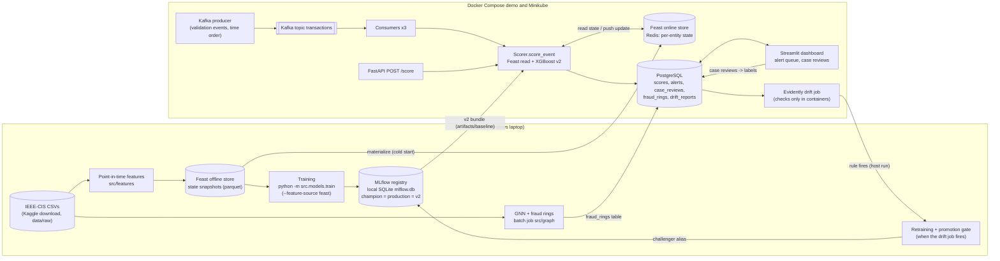

# Architecture

**Legend**

- Boxes are processes; cylinders are stores; the double-bordered box is the Kafka topic.
- **Host only:** MLflow (local SQLite file, no server), training, retraining and promotion, the
  GNN, the fraud-ring job, EDA and reports. Retraining stays on the host because the registry's
  artifact paths are Windows paths that a container cannot open.
- **Docker Compose** (`docker-compose.yml`, the full demo: 118,108 streamed events): Kafka,
  PostgreSQL, Redis, API, 3 consumers, dashboard, and a one-shot drift service (checks only).
  The producer and the Feast materialize step run from the host.
- **Minikube** (`k8s/`, namespace `fraud-k8s`, a 20-event replay): the same services, plus a
  materialize Job, a producer Job and a drift CronJob every 6 h (`--no-retrain`, checks only).
- Features: Feast stores per-entity state; training (offline store) and serving (Redis) compute
  the features from it with the same function, `entity_state.history_features`
  ([feature_store.md](feature_store.md)).
- Labels: analyst reviews are stored append-only in `case_reviews`; they are not yet used for
  retraining.
- Details: [serving.md](serving.md), [feature_store.md](feature_store.md),
  [gnn.md](gnn.md), [monitoring.md](monitoring.md), [dashboard.md](dashboard.md),
  [kubernetes.md](kubernetes.md).
