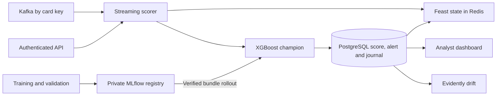

# Interview walkthrough and engineering reflection

## Problem and evaluation

The platform turns a Kafka message or authenticated API request into a fraud
score and makes alerts explainable to analysts. The XGBoost champion achieved
validation PR-AUC 0.2992 and ROC-AUC 0.8464. GraphSAGE reached validation
PR-AUC 0.2021. The model decision follows these measured comparisons. Use
the [demo checklist](demo.md) and [model report](../reports/model_v1_vs_v2.md).

## Online path

Demonstrate one score, its repeat response, and the dashboard explanation.
Then walk through the pending journal, Redis read-back, and Kafka commit.
[Architecture and operational boundaries](architecture.md)

## What the evidence changed

- Point-in-time rules had to agree across training, graph sampling, replay and live state. An independent batch oracle made it possible to find discrepancies without destroying the original stores.
- Database commits protect scores. The journal and Redis read-back establish whether subsequent scoring can safely use the corresponding features.
- GraphSAGE, blending and ring ranking were tested separately. Device model strings and proxy accounts limit the graph’s meaning, and the graph results did not justify serving it.
- Hosted CI, private capacity and exact-image recovery establish different facts. The [release checklist](production-readiness.md) ties each decision to the artifact and environment that produced its evidence.
